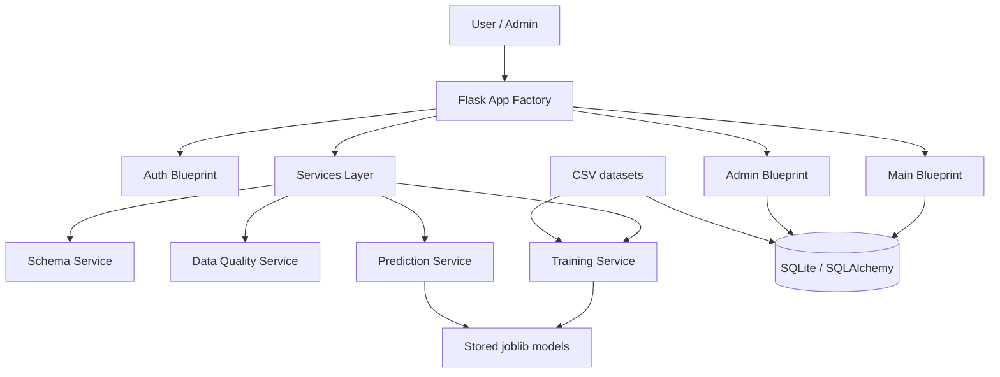

# Architecture overview

## Design summary

The project keeps the original Flask app structure but adds a multi-company model layer. Each company has its own dataset, schema, trained model, thresholds, and access rules. This allows the application to be adapted to different industries without hard-coded rules in the route layer.

## Why this is scalable

- Each company has a dedicated dataset file and model snapshot.
- The schema is stored as JSON to allow different columns per company.
- The training layer builds a generic pipeline using scikit-learn.
- Prediction and risk logic are separated from the route code to improve testing and maintainability.
